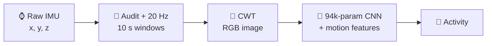

  
  
  

---

## 👋 About Me

I'm an **MSc student in Computer Science** at National Dong Hwa University (Taiwan), in the **Intelligent Computing and Mobile Network Lab**. I build machine learning systems end to end, from **raw sensor data to compact, carefully tested models**, with a focus on **healthcare**.

- 🎓 **MSc** in Computer Science, NDHU (2025 – 2027), ranked **1st of 11** in my first semester
- 🔬 **Research:** Human Activity Recognition from cheap phone and smartwatch IMUs, and efficient medical vision-language models
- 📄 **First-author paper** at IEEE R10-HTC 2026 (Bangkok, oral presentation)
- 💼 **Open to** AI/ML engineering roles in Taiwan and abroad
- 🎮 **Hobbies:** game development, VR and content creation
- 🌎 **Languages:** Spanish (native), English (fluent), Chinese (conversational)

 

---

## 🧪 Research

### 🏃 Thesis: Human Activity Recognition from Low-Cost IMU Sensors

I'm building a preprocessing pipeline that turns **raw accelerometer data from phones and smartwatches** into **Continuous Wavelet Transform (CWT)** images for CNNs, aimed at **medical and hospital use**. The long-term goal is a multi-sensor model where cheap sensors complement each other.

| Result (WISDM, tested on 10 people never used in training) | Accuracy | Macro F1 |
|:--|:--:|:--:|
| Always guess "Walking" | 45.4% | – |
| Best published subject-wise result (ConvFormer, *Sensors* 2026) | 88.9% | 78.8 |
| **My CNN (3 seeds)** | **92.1% ± 0.4** | **88.5 ± 0.3** |

**Key finding:** how the image is built moves the score by up to **5.5 points**, while a **16× change in network size does not**. Random train/test splits inflate results by about 10 points, so every number here is split by person.

> [!NOTE]
> **Next:** replication on MotionSense and HAPT, then accelerometer + gyroscope fusion across devices.

### 🩺 Quantization of Medical Vision-Language Models

Does a compressed medical AI model still **look at the image**, or does it answer from the question alone?

- Evaluated **Qwen2-VL-2B** and **Qwen2.5-VL-3B** on **VQA-RAD** and **SLAKE**, from 16-bit down to 2-bit weights, with no-image and shuffled-image controls
- Found and fixed a **bfloat16 tie bug** that shifted results by up to 8 points
- Measured real GPU latency and energy: **INT8 was 2.0× slower and used 1.5× more energy** than bf16

`PyTorch` `Hugging Face` `bitsandbytes` `VLMs` `Energy measurement`

---

## 🚀 Current Status

| | |
|:--|:--|
| 🔭 **Working on** | Replicating my HAR pipeline on a second dataset |
| 🌱 **Learning** | Real-time optimization of deep learning models on edge devices |
| 👁️ **Exploring** | Computer vision applications in my free time |
| ⚡ **Fun fact** | I like content creation |

---

## 🏆 Highlights

| | Achievement |
|:--:|:--|
| 📄 | **IEEE R10-HTC 2026**, first author and oral presenter: *AIoT Wearable System for Safety-Critical Sound Detection in Sensory-Impaired Users* (Bangkok, Thailand) |
| 🥇 | **1st of 11 in class ranking**, MSc Computer Science, NDHU (Fall 2025, GPA 4.31) |
| 🎖️ | **Oral Presentation Honorable Mention**, 2026 Taiwan–Korea VIP International Exchange Workshop, for part of my HAR thesis work |
| 🥈 | **2nd Place, Project Presentation Award**, 2025 Taiwan–Korea VIP International Exchange Workshop, for Safe & Sound |
| 🏅 | **Excellence Award**, NDHU CSIE Undergraduate Project Exhibition (2025) |

---

## 📌 Featured Projects

<table>
<tr>
<td width="50%" valign="top">

### 🔊 Safe & Sound
AIoT wearable that detects alarms, sirens and horns and shows their direction, for sensory-impaired users. YAMNet + GCC-PHAT on a Realtek AMB82-Mini.

`Edge AI` `Arduino` `Android` `Firebase`

</td>
<td width="50%" valign="top">

### 🚁 VR Drone Simulator
Drone flight simulator for Meta Quest, built in Unity with ML-Agents.

`Unity` `C#` `ML-Agents` `VR`

</td>
</tr>
<tr>
<td width="50%" valign="top">

### 🎯 VR Dodgeball
Dodgeball game for Meta Quest.

`Unity` `C#` `Meta Quest`

</td>
<td width="50%" valign="top">

### 🐦 CS50 Final Project
Flappy Bird-inspired game in Python (pygame). Harvard CS50P certificate.

`Python` `pygame`

</td>
</tr>
</table>

---

## 🛠 Tech Stack

**🧠 AI / ML & Data**
 

 
   

**💻 Languages**
 

**📡 IoT & Mobile**
 

 
  

**🎮 Game Dev & Design**
 

**🧰 Tools**
 

---

## 📊 GitHub Stats

  
  
   
  
   
  

---

  

