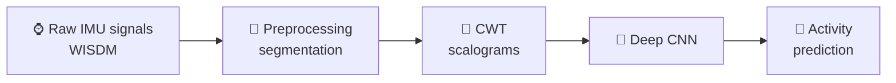

  
  
  

---

## 👋 About Me

I'm an **MSc student in IoT and embedded machine learning** at National Dong Hwa University (Taiwan), working where **AI meets signal processing**. My research makes wearable sensor data understandable to machines, for **healthcare and human-centered applications**.

- 🎓 **MSc** in Computer Science & Information Engineering, NDHU (2025 – present)
- 🔬 **Research:** Human Activity Recognition (HAR) from IMU sensors
- 📄 **First-author paper** at IEEE R10-HTC 2026 (Bangkok, oral presentation)
- 🎮 **Hobbies:** game development, VR and content creation
- 🌎 **Languages:** Spanish (native), English (fluent), Chinese (conversational)

 

> [!IMPORTANT]
> **🧪 Thesis Focus: Human Activity Recognition (HAR)**
> I'm building a pipeline that transforms raw IMU signals from the **WISDM dataset** into spectral images with the **Continuous Wavelet Transform (CWT)**, then classifies them with **deep CNNs**.

---

## 🚀 Current Status

| | |
|:--|:--|
| 🔭 **Working on** | Fine-tuning CWT parameters for high-dimensional sensor data |
| 🌱 **Learning** | Real-time optimization of deep learning models on edge devices |
| 👁️ **Exploring** | Computer vision applications in my free time |
| ⚡ **Fun fact** | I like content creation |

---

## 🏆 Highlights

| | Achievement |
|:--:|:--|
| 📄 | **IEEE R10-HTC 2026**, first author and oral presenter: *AIoT Wearable System for Safety-Critical Sound Detection in Sensory-Impaired Users* (Bangkok, Thailand) |
| 🥇 | **Oral Presentation Honorable Mention**, 2026 Taiwan–Korea VIP International Exchange Workshop |
| 🥈 | **2nd Place, Project Presentation Award**, VIP Global Student Workshop (2025) |
| 🏅 | **Excellence Award**, NDHU CSIE Undergraduate Project Exhibition (2025) |

---

## 📌 Featured Projects

<table>
<tr>
<td width="50%" valign="top">

### 🏃 Human Activity Recognition
IMU signals → CWT scalograms → deep CNNs for activity classification.

`Python` `PyTorch` `TensorFlow` `Signal Processing`

</td>
<td width="50%" valign="top">

### 🔊 Safe & Sound
AIoT wearable that detects alarms, sirens and horns and shows their direction, for sensory-impaired users. YAMNet + GCC-PHAT on a Realtek AMB82-Mini.

`Edge AI` `Arduino` `Android` `Firebase`

</td>
</tr>
<tr>
<td width="50%" valign="top">

### 🚁 VR Drone Simulator
Drone flight simulator for Meta Quest, built in Unity with ML-Agents.

`Unity` `C#` `ML-Agents` `VR`

</td>
<td width="50%" valign="top">

### 🎯 VR Dodgeball
Dodgeball game for Meta Quest.

`Unity` `C#` `Meta Quest`

</td>
</tr>
</table>

---

## 🛠 Tech Stack

**🧠 AI / ML & Data**
 

**💻 Languages**
 

**📡 IoT & Mobile**
 

**🎮 Game Dev & Design**
 

**🧰 Tools**
 

---

## 📊 GitHub Stats

  
  
   
  
   
  

---

  

